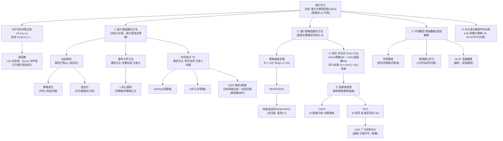

# 第12章 深度强化学习 —— 知识图谱

> 来源:《神经网络与深度学习》(nndl-v2) 第12章,PDF 第343–375页
> 核心命题:**智能体通过与环境的交互,依据奖励信号不断改进策略,最大化长期期望回报** 𝒥(θ)=𝔼[G₀]

---

## 一、总览图谱

---

## 二、核心概念脉络

### 1. 强化学习问题(12.1)——「是什么」
- **与监督学习的三个区别**:序列决策(动作影响后续数据)、延迟奖励(贡献度分配)、探索-利用权衡
- **标准形式**:折扣 MDP `(𝒮, 𝒜, p, r, γ)`
  - 状态 s、动作 a、策略 π(a|s)(确定性/随机性)、转移概率 p(s'|s,a)、即时奖励 r(s,a,s')、折扣率 γ
- **典型例子**:多臂赌博机(无显式状态转移)、悬崖行走(网格世界)
- **目标函数**:总回报 Gₜ = Σ γᵏ·r;回合式任务 vs 持续式任务;γ 控制短/长期收益偏好
- **值函数**:V^π(s) = E[Gₜ|s]、Q^π(s,a) = E[Gₜ|s,a];二者由**贝尔曼方程**互相递推(压缩映射→收敛)
- **深度强化学习的四条思路**:① 值函数近似(DQN) ② 策略函数近似(REINFORCE) ③ 演员-评论员(AC/PPO) ④ 环境模型学习

### 2. 基于值函数的方法(12.2)——「先算价值再选动作」
| 方法 | 模型 | 特点 | 代表 |
|------|------|------|------|
| 动态规划 | 已知 | 策略迭代(评估+改进)/ 值迭代(贝尔曼最优方程) | Policy/Value Iteration |
| 蒙特卡罗 | 未知 | 完整轨迹取平均回报;无偏但方差大;ε-贪心引入探索 | MC |
| 时序差分 | 未知 | 单步自举,效率高但有偏 | SARSA(同策略)、Q学习(异策略) |
| **DQN** | 未知 | 神经网络近似 Q;两大关键技术:**目标网络冻结**(稳定目标)+**经验回放**(打破样本相关) | Mnih 2015 |

### 3. 基于策略函数的方法(12.3)——「直接优化策略」
- **策略梯度定理**:∇𝒥(θ) = 𝔼[Σₜ ∇logπ_θ(aₜ|sₜ) · γᵗ·Gₜ](与转移概率无关,只依赖策略)
- **REINFORCE**:蒙特卡罗式,每回合采样一条轨迹更新
- **带基准线 REINFORCE**:引入与动作无关的基准 b(sₜ)=V(sₜ),用 `Gₜ−b(sₜ)` 作为权重 → **降低方差**

### 4. 演员-评论员(12.4)——「策略+价值双网络」
- Actor 学策略 π_θ,Critic 学值函数 V_φ,通过 **TD误差 δ = r + γV_φ(s') − V_φ(s)** 连接
- 优点:单步更新,不需要等回合结束;Critic 兼作基准线减方差
- 带基准线 REINFORCE 与 AC 的区别:AC 用 TD 估计回报,而非整条轨迹

### 5. 信赖域与近端策略优化(12.5)——「让更新更稳」
- **为什么需要信赖域**:① 步长难控制 ② 样本利用率低(旧数据不服从新策略) ③ 更新缺少约束
- **优势函数** A = Q − V:衡量"相对平均而言这个动作更好还是更差"
- **代理目标 + 重要性采样**:用旧策略采样、评估新策略 `r_t(θ) = π_θ/π_old`
- **TRPO**:显式 KL 散度约束 ≤ δ(需共轭梯度,实现复杂)
- **PPO**:两种形式——KL 惩罚项 / **裁剪目标** `min(r_t·A, clip(r_t,1±ε)·A)`
  - 工程优势:固定数据可多个 epoch 复用
- **GAE**:多步 TD 误差的指数加权 Σ(γλ)ˡ·δ,λ 控制偏差-方差折中

### 6. 环境模型、离线数据与奖励建模(12.6)——「样本和奖励从哪来」
| 设置 | 样本来源 | 主要风险 |
|------|---------|---------|
| 在线无模型 RL | 当前/旧策略与真实环境交互 | 交互成本高、探索不安全 |
| 基于模型 RL / 世界模型 | 学习的转移/奖励/隐空间模型 | 模型偏差在长时程推演中累积 |
| 离线 RL | 固定数据集(行为策略收集) | 分布外动作价值过度乐观 |
| RLHF | 偏好反馈训练奖励模型 | 奖励过度优化、分布偏移 |

### 7. 在大语言模型中的应用(12.7)
- 语言模型 = 参数化策略 π_θ(yₜ|x, y<ₜ);状态=输入+生成历史,动作=下一词元,轨迹=整段回答
- 本章的策略梯度、优势估计、KL 约束、PPO 裁剪可直接迁移(详见第13章)

---

## 三、统一学习闭环(12.8)

所有算法都可概括为 **「执行策略生成样本 → 估计回报/价值 → 更新策略/价值函数」**:

| 算法 | 生成样本 | 估计回报 | 更新策略 |
|------|---------|---------|---------|
| SARSA | s,a,r,s',a' | Q←Q+α(r+γQ(s',a')−Q) | π(s)=argmaxQ |
| Q学习 | s,a,r,s' | Q←Q+α(r+γmaxQ(s',a')−Q) | π(s)=argmaxQ |
| REINFORCE | 整条轨迹 τ | Gₜ=Σγᵏr | θ←θ+Σ∇logπ·γᵗGₜ |
| Actor-Critic | s,a,s',r | Ĝₜ=r+γV_φ(s') | φ、θ 双更新(经 TD 误差) |

**扩展阅读方向**:世界模型、POMDP(部分可观测)、逆向强化学习 IRL、分层强化学习 HRL
**经典参考**:Sutton & Barto《Reinforcement Learning: An Introduction》;DQN 系列(双Q、优先级回放、决斗网络);连续控制(DDPG、A3C、TD3、SAC)

---

## 四、一页速记(汇报版)

> **1 个目标**:最大化期望回报 E[G₀]
> **1 个框架**:马尔可夫决策过程 (S,A,p,r,γ)
> **3 大挑战**:序列决策 · 延迟奖励 · 探索-利用
> **4 条主线**:值函数(DQN)→ 策略函数(REINFORCE)→ 演员-评论员(PPO)→ 环境模型(世界模型/离线/RLHF)
> **2 个关键技术**:DQN(目标网络+经验回放)、PPO(裁剪目标+GAE)
> **1 个统一视角**:回报估计 → 策略改进
